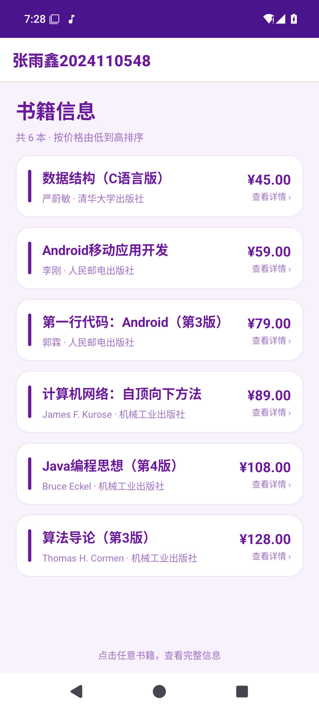
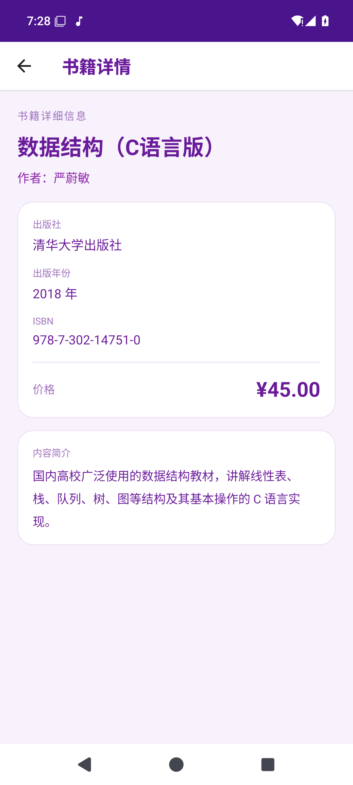

# 书籍信息管理（ZhangYuxinBookList）

四川师范大学 计算机科学学院《Android 移动应用开发》上机测试（期中）项目。

- 姓名：张雨鑫
- 学号：2024110548
- 包名：`cn.edu.sicnu.stu.zhangyuxin.qizhong`
- 仓库地址：https://github.com/zhangyuxin666/Andriod-qizhong

## 功能说明

1. **书籍实体类** `Book`：封装书名、作者、出版社、价格、出版年份、ISBN、内容简介等属性。
2. **第 1 个 Activity（MainActivity）**
   - 在代码中创建 6 个书籍对象并放入 `List<Book>` 数组；
   - 使用 `Collections.sort` 按价格由低到高排序；
   - 使用 `ListView` + 自定义 `BaseAdapter` 以卡片列表显示书籍；
   - 单击条目通过 `Intent` 携带 `Serializable` 对象启动第 2 个 Activity；
   - 标题设置为「张雨鑫2024110548」。
3. **第 2 个 Activity（BookDetailActivity）**
   - 接收并显示被选中书籍的完整信息；
   - 支持 ActionBar 返回箭头与系统返回键。
4. **文字颜色**：学号尾号为 8，对应紫色，APP 内文字统一使用紫色（#6A1B9A）系配色。

## 运行截图

| 书籍列表（按价格升序） | 书籍详情 |
| --- | --- |
|  |  |

## 项目结构

```
ZhangYuxinBookList
├── app/src/main/java/cn/edu/sicnu/stu/zhangyuxin/qizhong/
│   ├── Book.java               书籍实体类
│   ├── BookAdapter.java        列表适配器
│   ├── MainActivity.java       第 1 个 Activity（排序 + 列表）
│   └── BookDetailActivity.java 第 2 个 Activity（详情）
├── app/src/main/res/layout/    界面布局
└── report/                     实验报告
```

## 实验报告

实验报告见 [report/实验报告-2024110548张雨鑫.docx](report/实验报告-2024110548张雨鑫.docx)，其中包含运行界面截图与主要代码。

## 提交记录

- 第一次提交：新建项目，实现书籍信息管理 APP（列表排序 + 详情页）
- 第二次提交：补充运行截图、实验报告与代码整理（检查前提交，检查后不再提交）

## 构建与运行

使用 Android Studio 打开工程，或在命令行执行：

```bash
gradlew assembleDebug
adb install -r app/build/outputs/apk/debug/app-debug.apk
```
